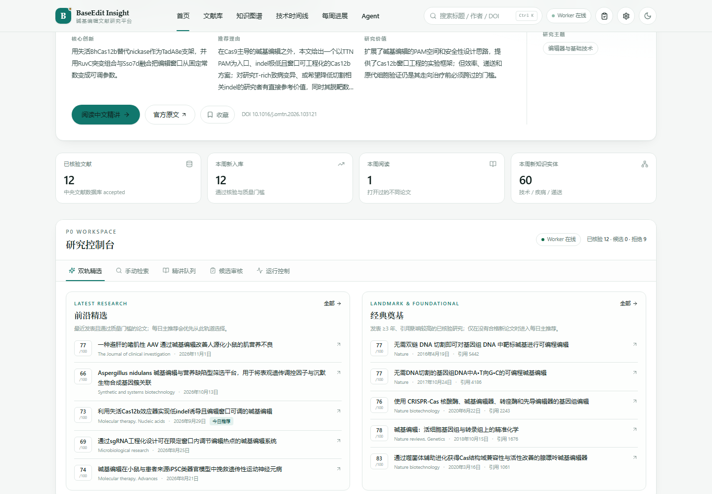
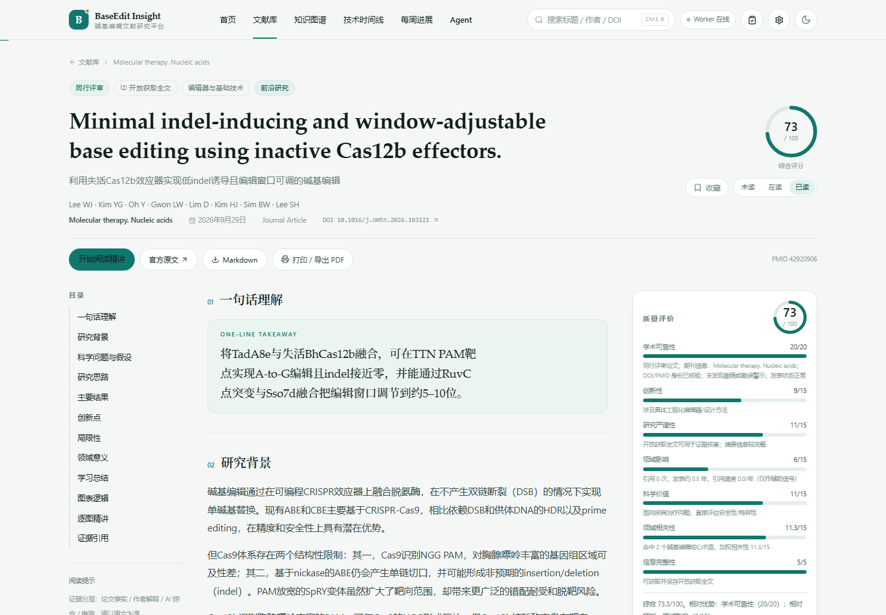
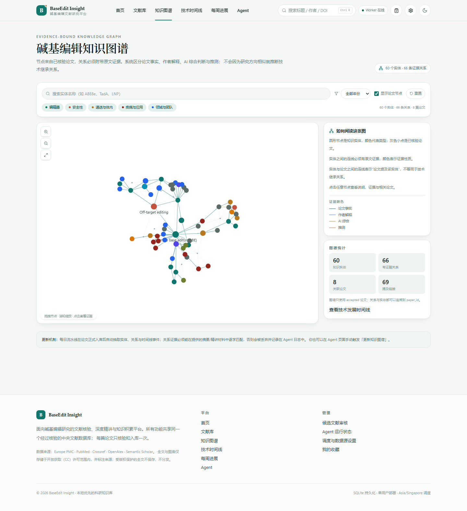
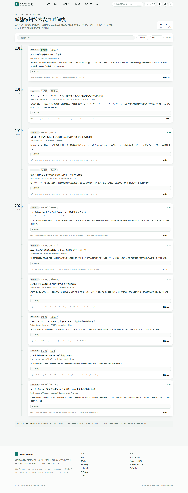
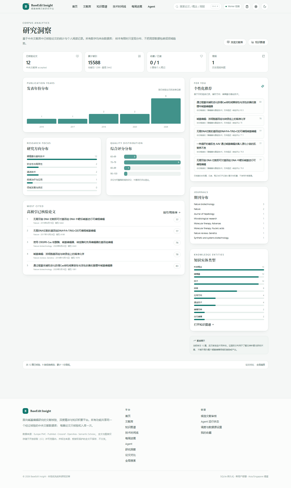
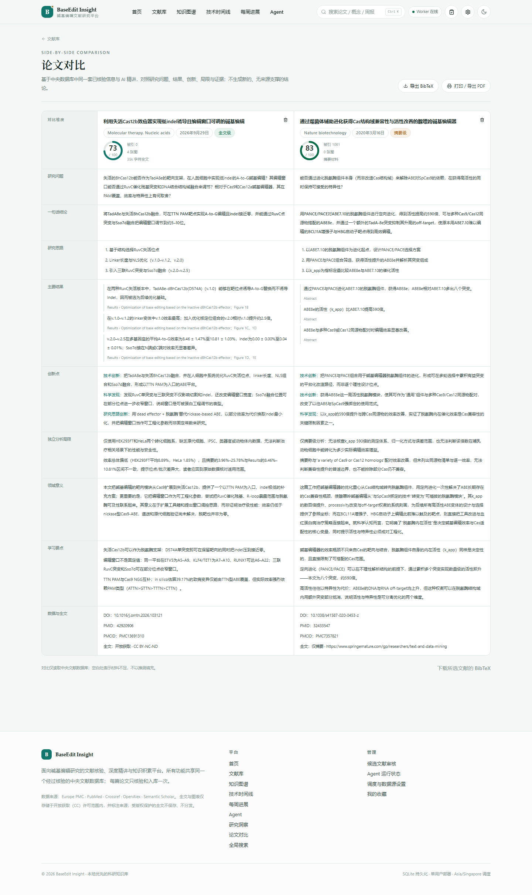

# BaseEdit Insight

**面向碱基编辑研究的本地优先文献知识平台**

真实检索 · 证据核验 · AI 中文精讲 · 逐图分析 · 知识图谱 · 技术时间线 · 每周进展

[](https://nextjs.org/)
[](https://www.typescriptlang.org/)
[](https://sqlite.org/)
[](https://nodejs.org/)



---

## 这是什么

BaseEdit Insight 是一个可以自己部署、长期积累的 **碱基编辑（base editing）文献研究客户端**。

它从 Europe PMC、PubMed、Crossref 等真实学术源发现论文，完成去重、DOI/PMID 核验、撤稿检查与质量评估后，写入唯一的中央文献数据库；再基于同一份数据生成中文深度精讲、Figure-by-Figure 分析、知识图谱、技术时间线和每周研究进展报告。

它不是一个论文搜索页面的拼装，也不是把摘要直接丢给大模型的工具。每篇论文只有一条主记录（`paper_id`），每条 AI 结论都尽量绑定原文证据；未通过核验的论文不会进入推荐、图谱、时间线或周报。

---

## 主要功能

### 每日精选与双轨推荐
- 每天从已核验论文中选出一篇综合价值最高的主推荐；
- **前沿研究 / 经典奠基** 双轨并存；没有合格新论文时回退经典，不为完成任务降低门槛；
- 展示评分、推荐理由、核心创新、研究价值、官方链接与全文状态。

### AI 中文深度精讲
- 研究背景、核心科学问题、技术路线、主要结果、创新点、局限性、领域意义、学习总结、术语与阅读指南；
- 严格区分**全文级分析**与**摘要级分析**；
- 明确区分论文事实、作者解释、AI 综合判断与推测。

### Figure-by-Figure 逐图精讲
- 解析 Europe PMC 开放获取 JATS 全文中的 Figure 编号、图注与子图；
- 原始图片与中文分析并排展示，支持放大查看；
- 图注缺失或版权受限时只提供官方来源，不生成虚假图表。

### 知识图谱与技术时间线
- 实体去重（含别名）、有向关系与逐字原文证据；
- 时间线区分「论文发表」「首次报告」「后续验证」，不把发表日当作技术发明日。

### 每周研究进展
- 直接读取中央数据库，区分「本周新发表」「新检索到的历史论文」「本周通过核验并入库」；
- 支持 Markdown 导出与浏览器打印 PDF。
### 全局搜索与论文对比
- 一次搜索已核验论文、知识实体、有证据关系、技术时间线与周报；
- 在文献卡片点击「对比」，最多选择 3 篇论文，并排比较研究问题、结果、创新、局限与全文状态；
- 支持导出所选论文的 BibTeX。

### 研究洞察与个性化推荐
- 发表年份、研究方向、评分分布、期刊、知识实体类型、高被引论文等数据库统计；
- 依据个人收藏、已读、笔记与打开记录计算方向权重，推荐未读论文；
- 明确标注样本量限制，不把局部统计包装成领域趋势。


### 研究控制台
首页集成了 P0 工作台：**双轨精选 / 手动检索 / 精讲队列 / 候选审核 / 运行控制**，日常操作不需要在多个页面之间切换。

### 其他
- 历史文献库：标题 / 作者 / DOI / 关键词 / 年份 / 期刊 / 方向 / 评分 / 阅读状态筛选；
- 收藏、已读状态、阅读进度、个人笔记；
- 候选与正式文献严格隔离，支持人工审核但不可绕过核验门槛；
- 深色模式、响应式布局；
- 独立 worker：真实队列、cron 调度、心跳、重试、超时恢复与真实日志。

---

## 界面

| 论文精讲 | 知识图谱 |
| --- | --- |
|  |  |

| 技术时间线 | 研究洞察 |
| --- | --- |
|  |  |

| 论文对比 |
| --- |
|  |

---

## 快速开始

### 环境要求

- **Node.js 22+**（已在 Node 24 验证）
- 不需要 PostgreSQL、Redis 或 Docker
- AI 功能二选一：
  - 本机已安装并登录 [Claude Code](https://docs.anthropic.com/claude-code)（默认，无需额外 API Key）
  - 或使用 Anthropic Messages API Key

### 安装与启动

```bash
git clone https://github.com/RaBB1tG1aSS/baseedit-insight.git
cd baseedit-insight

npm install

# 1) 配置（至少把占位邮箱改成自己的）
cp .env.example .env.local
# Windows: copy .env.example .env.local

# 2) 初始化数据库
npm run db:migrate

# 3) 同时启动 Web 与 Worker
npm run dev:all
```

打开 <http://localhost:3000>。

> **Worker 必须运行。** 检索、核验、精讲、周报都是后台任务；只启动 Web 时任务会停在队列里。关闭浏览器不影响定时任务，关闭 Worker 才会。

### Windows 一键启动（静默后台）

仓库提供无控制台窗口的启动方式：

1. 首次运行一次快捷方式安装脚本（PowerShell）：

   ```powershell
   powershell -NoProfile -ExecutionPolicy Bypass -File ./Install-BaseEdit-Shortcuts.ps1
   ```

2. 桌面会生成两个快捷方式：

   - **BaseEdit Insight**：后台启动 Web + Worker（无 cmd 窗口），等待健康检查通过后自动打开浏览器；
   - **BaseEdit Insight - Stop**：停止 Web 与 Worker。

启动日志写入：

- `data/prod-server.log`
- `data/worker.log`
- `data/launcher.log`

底层入口是 `Start-BaseEdit-Insight.vbs` / `Stop-BaseEdit-Insight.vbs`（调用同名 PowerShell 脚本）。

> 如果希望直接看到两个日志窗口，仍可使用 `Start-BaseEdit-Insight.cmd` / `Stop-BaseEdit-Insight.cmd`。

### 第一次使用

首次数据库是空的。任选一种方式开始：

**界面**：首页 →「研究控制台」→「运行控制」→「每日流水线」；或「立即运行检索」。

**命令行**：

```bash
npm run pipeline:run -- --limit=15 --since-days=120 --deep-reads=1 --figures=2
```

首次运行会真实访问学术 API，并根据 AI 配置生成精讲与图表分析，通常需要 **8–15 分钟**。Agent 页面可以实时查看检索、核验、入库、精讲与图谱更新日志。

### 生产模式

```bash
npm run build
npm run start:all     # Web + Worker
# 或分别运行：npm start / npm run worker
```

---

## 使用地图

| 页面 | 用途 |
| --- | --- |
| `/` | 今日精选、双轨推荐、P0 研究控制台 |
| `/papers` | 已核验文献库与筛选 |
| `/papers/[id]` | 中文精讲、逐图分析、证据引用、笔记与阅读进度 |
| `/graph` | 交互式知识图谱 |
| `/timeline` | 技术发展时间线 |
| `/insights` | 研究洞察、趋势分布与个性化推荐 |
| `/compare?ids=…` | 2–3 篇论文并排对比 |
| `/search?q=…` | 跨论文、实体、关系、时间线与周报的全局搜索 |
| `/weekly` | 每周研究进展与历史周报 |
| `/agent` | 任务队列、真实进度、执行日志 |
| `/candidates` | 候选 / 未通过文献审核 |
| `/settings` | 调度、AI、质量门槛、数据源与备份 |

---

## AI 配置

### 默认：本机 Claude Code CLI（无需 API Key）

```env
AI_PROVIDER=claude-cli
```

要求终端可执行 `claude --version` 且已登录。应用通过结构化 JSON Schema 调用，失败会自动重试，并把模型、模板版本、生成时间与单次成本写入数据库。

### 可选：Anthropic API

```env
AI_PROVIDER=anthropic
ANTHROPIC_API_KEY=sk-ant-...
# 可选：ANTHROPIC_BASE_URL=
```

默认模型 `claude-sonnet-5-5`，可在设置页覆盖。

### AI 不可用时

检索、去重、核验、入库、质量评分和数据模板周报仍然可用；精讲、逐图分析和 AI 知识抽取会跳过，并在任务日志中明确说明。系统不会生成假分析。

---

## 数据来源与科研规范

| 来源 | 用途 | 认证 |
| --- | --- | --- |
| Europe PMC REST | 主检索、OA 全文 XML、图注、许可 | 无 |
| PubMed E-utilities | 补充检索、PMID / 撤稿 / 勘误核验 | 可选 API Key |
| Crossref | DOI 解析、题名一致性、撤稿关系 | 无 |
| OpenAlex | 引用数、撤稿状态 | 可选 mailto |
| Semantic Scholar | 引用补充（默认关闭） | 可选 Key |

- 只保存 **CC / CC0 开放许可** 的全文与图注；其他论文仅保存摘要、元数据与官方链接；
- 不下载、不保存、不分发受版权保护的 PDF；
- 图片直接引用 PMC CDN 原始地址，并标注来源与许可；
- AI 内容按「论文事实 / 作者解释 / AI 综合 / 推测」分层；
- 撤稿、勘误和关注声明会被持续复查，状态变化会标记受影响的 AI 内容为过期。

> 本平台用于科研文献阅读与证据理解，不提供可直接照搬的实验参数、序列设计、protocol 或操作优化指南。

---

## 架构

```text
Europe PMC / PubMed / Crossref / OpenAlex
                  │
                  ▼
        检索 → 去重 → 身份核验 → 撤稿检查 → 质量门槛
                  │
                  ▼
      SQLite 中央文献数据库（唯一 paper_id / 来源 / 证据）
                  │
      ┌───────────┼────────────┬──────────────┐
      ▼           ▼            ▼              ▼
   AI 精讲    逐图分析     知识图谱/时间线   每周报告
      └───────────┴────────────┴──────────────┘
                  │
                  ▼
        Next.js 客户端 + 独立 Worker
```

- **一个论文一条记录**：DOI / PMID / PMCID / OpenAlex 只作为匹配键，不产生重复论文；
- **统一访问层**：所有页面通过 Repository 读取数据，不维护第二份论文信息；
- **状态隔离**：只有 `accepted` 论文进入推荐、图谱、时间线与周报；
- **证据可追溯**：AI 关系与时间线事件必须能匹配原文片段，否则丢弃并记录日志。

更多细节见 [ARCHITECTURE.md](./ARCHITECTURE.md)。P0 功能审计见 [P0-AUDIT.md](./P0-AUDIT.md)。

---

## 调度与可靠性

- 默认时区 **Asia/Singapore**；每日 **08:00** 运行流水线；每周日 **18:00** 生成周报；
- Worker 使用 `node-cron` 精确触发 + 重启补偿，不依赖浏览器；
- 同一天 / 同一周的任务不会重复创建；
- 运行中任务超过 45 分钟无进度会重新排队，失败按次数重试；
- 所有进度和日志来自数据库真实状态，不使用模拟进度。

时间与质量门槛可在设置页修改，Worker 会在 30 秒内重新加载调度。

---

## 测试

```bash
npm test            # 37 个单元 / 数据库测试
npm run live:check  # 真实 Europe PMC / PubMed / Crossref 冒烟测试（不写库）
npm run build       # 生产构建
```

已覆盖：DOI 规范化、跨源去重、撤稿状态、质量评分边界、相关性门槛、PubMed 解析、候选隔离、单日推荐唯一、实体/关系去重、任务原子领取、设置持久化、BibTeX、全局搜索、个性化推荐与洞察聚合。

实际测试记录与浏览器 QA 结果见 [TESTING.md](./TESTING.md)。

---

## 部署

支持本地生产模式、Linux systemd、Docker Compose 与反向代理认证，详见 [DEPLOYMENT.md](./DEPLOYMENT.md)。

> 本项目按**单用户 / 内网**设计，没有账号体系。部署到公网前请在反向代理层增加认证。

---

## 已知限制

1. **只解析 Europe PMC OA JATS 全文**，不解析出版社 PDF；非 OA 论文为摘要级分析。
2. 图注与子图已解析，但不包含补充材料图，也没有子图裁切。
3. 质量评分是可解释的规则评分，不等同于同行评议结论；引用次数只作为辅助信号。
4. AI 输出由 JSON Schema 保证结构，不保证科学判断绝对正确；页面提供证据引用供核验。
5. 目前没有用户账号、权限体系与多租户隔离。
6. 周报 PDF 使用浏览器打印生成；BibTeX 导出尚未实现。
7. SQLite WAL 适合单机，请勿放在网络文件系统上。

---

## 文档

- [ARCHITECTURE.md](./ARCHITECTURE.md) — 数据模型、流水线、Agent 与一致性规则
- [DEPLOYMENT.md](./DEPLOYMENT.md) — systemd、Docker、备份恢复与反向代理
- [TESTING.md](./TESTING.md) — 实际测试与验收记录
- [P0-AUDIT.md](./P0-AUDIT.md) — P0 客户端功能审计
- [P1-P2-AUDIT.md](./P1-P2-AUDIT.md) — P1/P2 建设进度与剩余边界
- [.env.example](./.env.example) — 全部环境变量

---

## 贡献与安全

- 欢迎提交 Issue 或 Pull Request；
- 修改数据管线时请保持「候选与正式隔离」「证据可追溯」「不伪造文献」三条底线；
- 请勿提交 `.env.local`、数据库、截图或任何 API Key；
- 发现安全问题请通过 Issue 私下联系作者，不要在公开 Issue 中贴出密钥。

## License

本项目暂未附带开源许可证，默认保留所有权利。如需在其它项目或许可场景中使用，请先联系作者。
